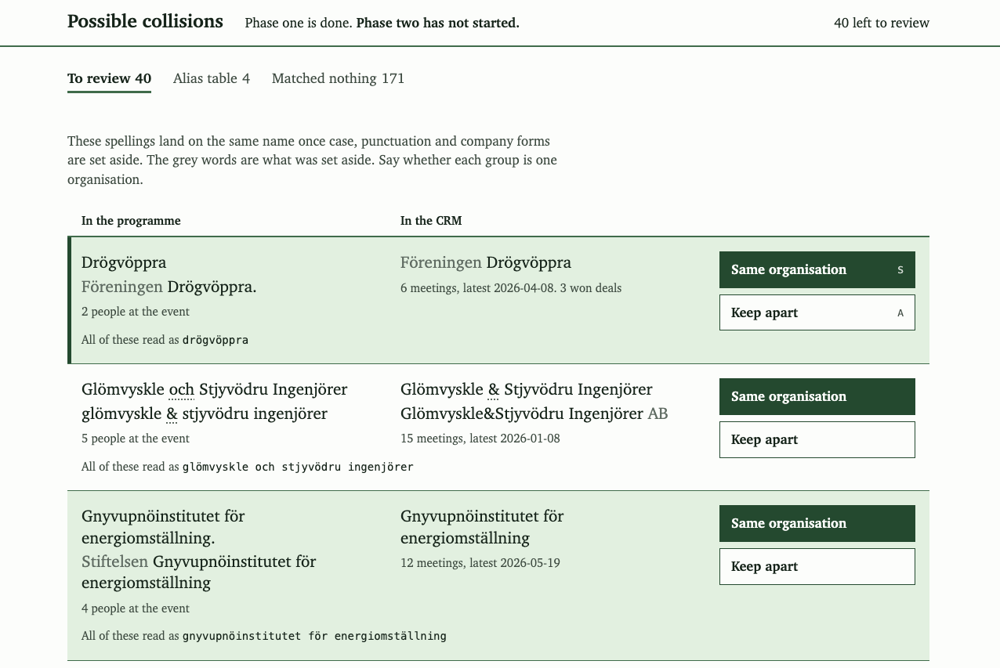
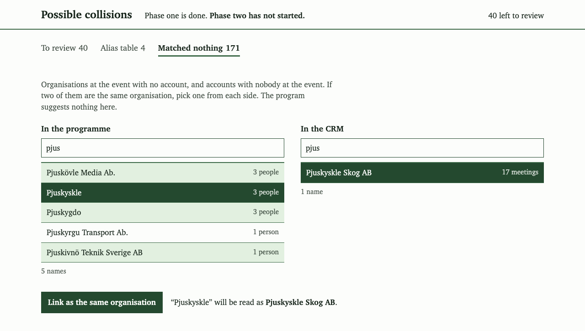
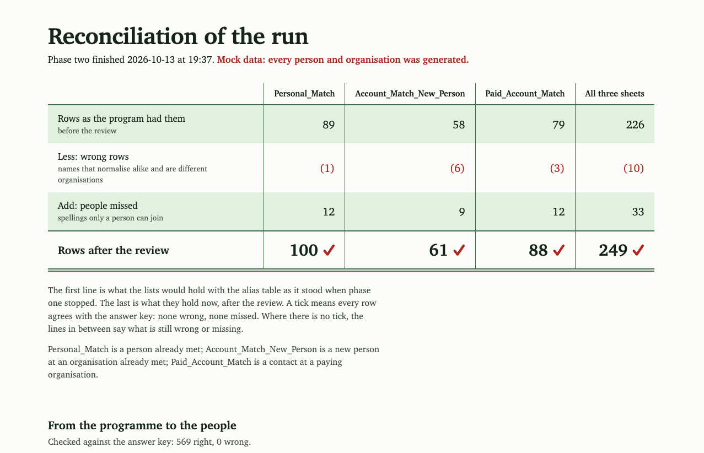

# lead-list-tools

This is a clean rebuild, for show, of a pipeline I designed at a previous job. All data in it is invented and generated by the repo itself. It is not the version that was used in production. The code is written from scratch; the design, the sheet names and the normalisation rules are the original's.

The case study, with the background and the real results, is at [oscarstrom.com/outreach-tools](https://oscarstrom.com/outreach-tools/).

## What it does

It scrapes a public event programme, matches the people in it against CRM exports, and writes lead lists for a sales team as Excel workbooks. A person checks the one step that matters before the lists are written.

1. **Scraper.** Reads every event page of a programme and writes one row per named person. A second scraper reads a congress platform through its JSON API.
2. **Municipality filter.** Matches each person's organisation against the official list of Sweden's 290 municipalities, with "stad" and "kommun" variants, the longest match winning and Region Gotland as a special case. A string that names a municipality and also looks like something else goes to a person. Writes three sheets: matched, rejected, parse issues.
3. **Normaliser.** Lowercases, collapses whitespace, strips punctuation and company forms such as AB, and writes "&" as "och". The same function runs on both sides of every comparison.
4. **Phase one.** Matches exactly on the normalised names, writes an audit workbook that lists only the possible collisions, prints STOP and exits.
5. **Alias table.** A YAML file a person edits after reading the collisions.
6. **Phase two.** Writes three sheets: a known person with their meeting history, a new person at a known organisation, and a contact at an organisation that has been a paying partner.

## Run the demo

You need [uv](https://docs.astral.sh/uv/). The repo pins Python 3.12 in `.python-version`; uv fetches it and the dependencies. The tests also pass on 3.13.

```
uv sync
uv run leadlist demo
```

The demo generates the mock data, serves a mock programme site and a mock congress API on your own machine, and runs every step. At the stop it prints STOP, says that it is carrying on only because this is a demo, and lets a stand-in reviewer make the decisions a person would. The stand-in reads the answer key. Everything lands in `work/output/`: six workbooks, `run_report.html`, and the same figures as data in `run_report.json` (the run) and `run_report_unreviewed.json` (the same lists scored with the alias table as it stood before the review).

The demo always starts from the dataset's own starting alias table and ends with the reviewed one, so it rewrites `config/org_aliases.yaml`. To put the starting table back: `git checkout config/org_aliases.yaml`, or `uv run leadlist generate --reset-aliases`.

To do the review yourself:

```
uv run leadlist demo --stop-at-review
uv run leadlist review        # the review screen, or edit config/org_aliases.yaml by hand
uv run leadlist phase2
```

Phase two refuses to run while a possible collision has no decision. `uv run leadlist phase2 --accept-undecided` runs it anyway and says how many were let stand.

`uv run leadlist --help` lists every step as its own subcommand. `uv run pytest` runs the tests.

## Design decisions

- **Exact matching, no fuzzy matching.** A wrong match costs more than a miss: it sends a salesperson to a stranger with someone else's history. Names are compared on a normalised form and nothing else; there is no similarity score. Where normalising joins different spellings, the program lists them for a person, who can keep them apart. Spellings that normalise differently are joined only when a person says so.
- **The alias table is the asset.** Every decision a person makes is kept in one small file that the next run starts from, and that every pipeline shares. An alias line also covers other spellings that normalise to the same name as one it lists. Phase two's refusal to run with undecided collisions is what keeps that from reaching the lists unseen: such a spelling is listed for review first.
- **The stop.** Phase one ends by listing the possible collisions. Phase two does not start until a person starts it. It refuses to run while a collision is undecided, unless told so in as many words, and refuses if the inputs have changed since phase one. A new spelling on an already decided name is listed again.
- **Show what was left out.** The filter writes its rejected rows and its parse issues next to its matches, with the reason for each.

## Handling what it reads

The scraped pages and the CRM exports are other people's text, so the tools treat them as hostile.

- A name that starts like a spreadsheet formula (`=`, `+`, `-`, `@`) is written to Excel as text, with a leading quote that the tools take off again when they read their own sheets.
- The scrapers stay on the site they were pointed at: links and redirects to another host are not followed, and page counts, response sizes and loops are capped.
- The review screen answers on this machine only, takes decisions only from its own page, and refuses to be framed by another site.
- The mock site is served on this machine only. A server found already running on its port is used only if it proves to be serving this same dataset.

## Added later, in this public version

The pipeline I designed ran in the terminal and wrote Excel workbooks. Three things here were not part of what ran in production:

- **The review screen** (`leadlist review`). A local page that shows each possible collision with the spellings from both sources side by side, and two actions, "Same organisation" and "Keep apart", that write the alias table. It never starts phase two.

  

  A second view lists what matched nothing, so that a person can join a short name to a full one by hand. The program suggests nothing there.

  

- **The run report** (`work/output/run_report.html`). Because the data is generated, the right answer is known for every row. The report says how many rows were right, wrong and missed, and compares the lists with what they would have held before the review. That comparison is there whenever the alias table has changed since phase one, in the demo or after a review by hand.

  

- **The mock data generator**, with a seed, so that anyone can make a bigger or messier dataset: `uv run leadlist generate --seed 7 --events 600`.

## About the mock data

Every person is invented, and so is every organisation except the municipalities. Municipalities carry their real names, from the official public list, because the filter exists to recognise them; the people placed at them are invented, and no municipality appears in the mock CRM. The other names are made up, and any resemblance to a real one is accidental. E-mail addresses end in `.example`. The starting alias table is generated too: a third of the decisions, as if they had been made for an earlier event. The spelling noise is deliberate: "&" against "och", company forms, casing, stray punctuation, abbreviations, "stad" against "kommun", one person listed twice, and pairs of organisations whose names normalise alike but must be kept apart.

## Stack

Python 3.12, pandas, openpyxl, requests and PyYAML. The pages are plain HTML and CSS with no framework and no external requests.

The code is written with Claude Code from my design.

## Licence

MIT. See [LICENSE](LICENSE).
